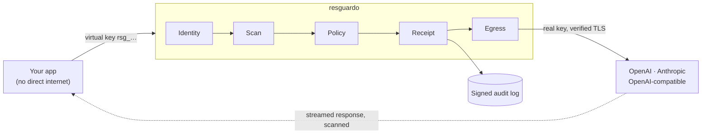

<h1 align="center">Resguardo</h1>

<p align="center">
  <strong>An egress boundary for LLM traffic.</strong><br>
  Nothing leaves without policy, and every decision leaves a signed receipt.
</p>

<p align="center">
  <a href="LICENSE"></a>
  
  
  
</p>

<p align="center">
  <a href="docs/GETTING_STARTED.md">Getting started</a> ·
  <a href="docs/ARCHITECTURE.md">Architecture</a> ·
  <a href="docs/THREAT_MODEL.md">Threat model</a> ·
  <a href="#roadmap">Roadmap</a>
</p>

---

Every prompt your application sends to a model provider leaves your network. It may carry customer data, an API key pasted into a support chat, or whatever a prompt injection convinced an agent to read. Most teams cannot answer two simple questions: **what left, and who allowed it?**

Resguardo is a single Rust binary that sits between your applications and the OpenAI and Anthropic APIs, or any OpenAI-compatible server (LiteLLM, vLLM, Ollama). Applications keep their official SDKs: change the base URL and the key, nothing else.

> [!WARNING]
> **Pre-alpha.** The proxy works end to end with the official SDKs against a mock provider. Scanning and the signed audit log are not built yet, so Resguardo refuses real providers for now.

## Highlights

- 🔒 **Closed by default.** Only listed providers and models get through, applications never see a real provider key, and any internal error blocks the request.
- 🧾 **A signed receipt for every decision.** A hash-chained, Ed25519-signed log that anyone can verify with the public key. It records decisions, never prompt content.
- 🇪🇸 **Spanish data, validated.** DNI, NIE, CIF and IBAN are detected only when their check digit is valid, with a measured and published false-positive rate.
- 🛡️ **Security first.** No `unsafe`, strict parsing so the scanner and the provider never read different values, and post-quantum TLS to the provider.
- ⚡ **One small binary.** No database and no runtime services: a TOML file, a JSONL log and a key pair.

## How it works



From the application's side, only two lines change:

```python
from openai import OpenAI

client = OpenAI(
    base_url="http://127.0.0.1:8787/v1",  # Resguardo instead of api.openai.com
    api_key="rsg_...",                     # a virtual key instead of the real one
)
client.chat.completions.create(
    model="gpt-4.1-mini",
    messages=[{"role": "user", "content": "Mi DNI es 12345678Z"}],
)
```

The provider receives `Mi DNI es [REDACTED:es_id:1]`, and a signed receipt records the decision. *(Redaction arrives in M3.)*

## Try it

```console
$ git clone https://github.com/christianivanov/resguardo && cd resguardo
$ tools/sdk-smoke/run.sh
ok   openai: chat completion through Resguardo
ok   anthropic: message with the key in x-api-key
ok   anthropic: message with the key as a bearer token
ok   openai: unknown key -> AuthenticationError
ok   openai: model outside the list -> PermissionDeniedError
...
ok   no virtual key reached the upstream
```

One command starts a mock provider and Resguardo, then calls them with the official OpenAI and Anthropic SDKs. It needs Rust, a C compiler and [uv](https://docs.astral.sh/uv/). No API key is needed, and no real provider is contacted. For a step-by-step walkthrough, see [Getting started](docs/GETTING_STARTED.md).

## Roadmap

| | Milestone | Status |
| --- | --- | --- |
| M0 | Foundations: workspace, licenses, ADRs, threat model | ✅ |
| M1 | Proxy: both APIs, virtual keys, limits, egress with post-quantum TLS | ✅ |
| M2 | Detectors: secrets, invisible text, de-obfuscation | ⏳ |
| M3 | Spanish validators, policy and redaction | ⏳ |
| M4 | Streaming and response controls | ⏳ |
| M5 | Signed audit log and `resguardo verify-log` | ⏳ |
| M6 | Accuracy corpus, benchmark, exfiltration lab, v0.1.0 | ⏳ February 2027 |

## Limits

Being honest about limits is part of the design. Resguardo does not detect prompt injection; it limits what an injection can send out. It does not find personal data without a structured format, such as names, and it does not scan images in v0.1. It only protects traffic that goes through it, so applications must not be able to reach the internet directly. The full list is in the [threat model](docs/THREAT_MODEL.md).

## Documentation

- [Getting started](docs/GETTING_STARTED.md): the demo, a step-by-step setup, SDK usage and error codes
- [Architecture and security](docs/ARCHITECTURE.md): crates, request path and the controls in code today
- [Threat model](docs/THREAT_MODEL.md) and [architecture decisions](docs/adr/)
- [Running Claude Code through Resguardo](docs/research/claude-code-gateway.md)

## Contributing

Not open to outside contributions yet. Commits require a [DCO](https://developercertificate.org/) sign-off (`git commit -s`).

## License

[Apache-2.0](LICENSE). *Resguardo* is Spanish for both a safeguard and a receipt.
