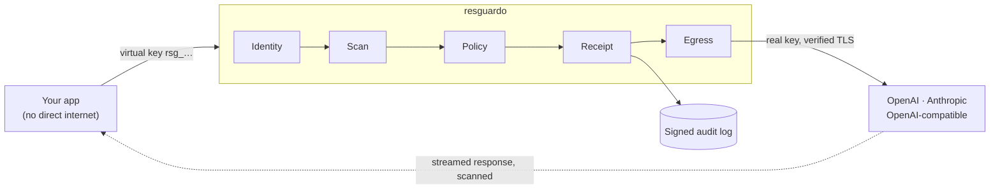

<h1 align="center">Resguardo</h1>

<p align="center">
  <strong>An egress boundary for LLM traffic.</strong><br>
  Nothing leaves without policy, and every decision leaves a signed receipt.
</p>

<p align="center">
  <a href="LICENSE"></a>
  
  
  
</p>

<p align="center">
  <a href="docs/GETTING_STARTED.md">Getting started</a> ·
  <a href="docs/ARCHITECTURE.md">Architecture</a> ·
  <a href="docs/THREAT_MODEL.md">Threat model</a> ·
  <a href="#roadmap">Roadmap</a>
</p>

---

Every prompt your application sends to a model provider leaves your network. It may carry customer data, an API key pasted into a support chat, or whatever a prompt injection convinced an agent to read. Most teams cannot answer two simple questions: **what left, and who allowed it?**

Resguardo is a single Rust binary that sits between your applications and the OpenAI and Anthropic APIs, or any OpenAI-compatible server (LiteLLM, vLLM, Ollama). Applications keep their official SDKs: change the base URL and the key, nothing else.

> [!WARNING]
> **v0.1, not yet released.** Everything is tested end to end with the official SDKs against a mock provider, but Resguardo has not been used in production. Read the [limits](#limits) before relying on it.

## Highlights

- 🔒 **Closed by default.** Only listed providers and models get through, applications never see a real provider key, and any internal error blocks the request.
- 🧾 **A signed receipt for every decision.** A hash-chained, Ed25519-signed log that anyone can verify with the public key. It records decisions, never prompt content.
- 🇪🇸 **Spanish data, validated.** DNI, NIE, CIF, IBAN and cards are detected only when their check digit is valid, with false-positive rates measured on a Spanish corpus and [published](docs/ACCURACY.md).
- 🛡️ **Security first.** No `unsafe`, strict parsing so the scanner and the provider never read different values, post-quantum TLS to the provider, and remote images and unknown links removed from answers.
- ⚡ **One small binary.** No database and no runtime services: a TOML file, a JSONL log and a key pair.

## How it works



From the application's side, only two lines change:

```python
from openai import OpenAI

client = OpenAI(
    base_url="http://127.0.0.1:8787/v1",  # Resguardo instead of api.openai.com
    api_key="rsg_...",                     # a virtual key instead of the real one
)
client.chat.completions.create(
    model="gpt-4.1-mini",
    messages=[{"role": "user", "content": "Mi DNI es 12345678Z"}],
)
```

The provider receives `Mi DNI es [REDACTED:es_id:1]`, and a signed receipt records the decision. `resguardo verify-log` checks every receipt with the public key.

## Try it

```console
$ git clone https://github.com/christianivanov/resguardo && cd resguardo
$ tools/sdk-smoke/run.sh
ok   openai: chat completion through Resguardo
ok   anthropic: message with the key in x-api-key
ok   anthropic: message with the key as a bearer token
ok   openai: unknown key -> AuthenticationError
ok   openai: model outside the list -> PermissionDeniedError
...
ok   openai: a DNI reaches the provider redacted  (echo: Mi DNI es [REDACTED:es_id:1])
ok   openai: an AWS key -> PermissionDeniedError
...
ok   no virtual key reached the upstream
ok   audit log verifies: OK (30 entries)
```

One command starts a mock provider and Resguardo, then calls them with the official OpenAI and Anthropic SDKs. It needs Rust, a C compiler and [uv](https://docs.astral.sh/uv/). No API key is needed, and no real provider is contacted. For a step-by-step walkthrough, see [Getting started](docs/GETTING_STARTED.md).

### See it stop an exfiltration

The [lab](lab/README.md) runs the same attack twice with Docker: from an application on a network that can only reach Resguardo, and from the same application with direct internet access.

```console
$ docker compose -f lab/docker-compose.yml run --rm app
ok   the application cannot reach the attacker directly
ok   a provider key in the prompt is blocked
ok   the DNI reached the provider as [REDACTED:es_id:1]
ok   the image pointing at the attacker was removed from the answer
$ docker compose -f lab/docker-compose.yml --profile unprotected run --rm app-unprotected
LEAK the application reached the attacker directly
LEAK a provider key in the prompt reached the provider
...
```

## Accuracy and cost

Measured on a synthetic Spanish corpus of 406 texts and on a 2017 laptop; both reproduce with one command ([accuracy](docs/ACCURACY.md), [benchmarks](docs/BENCHMARKS.md)).

| | |
| --- | --- |
| False positives, Spanish ids (DNI, NIE, CIF) | 0.3 % of 306 negatives |
| False positives, IBAN, email, secrets | 0 % |
| False positives, cards / phones | 0.7 % / 2.9 % |
| Missed | 3 of 100 positives, all a known gap (an id glued to letters) |
| Latency added, receipt flushed to disk (`fsync`) | 10.7 ms p50, dominated by this laptop's disk |
| Latency added, without `fsync` | 0.5 ms p50 |

The CI fails if any detector gets worse than these numbers.

## How it compares

Gateways such as LiteLLM, Portkey or Bifrost route traffic across many providers, manage keys and budgets, and can mask personal data. Resguardo does less, on purpose:

- **It is an egress boundary, not a router.** Closed by default: a destination or model not on the key's list never gets a request, and the application never holds a real provider key.
- **Every decision has a signed receipt** that a third party verifies with a public key, without trusting the operator's database.
- **Spanish identifiers are validated**, not just matched, and the error rates are published.
- **It is one binary** with no database or services to run.

What it does not do: load balancing, fallbacks, caching, budgets, dashboards, embeddings, images, or any provider API beyond OpenAI Chat Completions and Anthropic Messages. Put it behind your gateway, or in front of a single provider.

## Roadmap

| | Milestone | Status |
| --- | --- | --- |
| M0 | Foundations: workspace, licenses, ADRs, threat model | ✅ |
| M1 | Proxy: both APIs, virtual keys, limits, egress with post-quantum TLS | ✅ |
| M2 | Detectors: secrets, invisible text, de-obfuscation, `resguardo scan` | ✅ |
| M3 | Spanish ids, IBAN, cards, phones and email; policy and redaction | ✅ |
| M4 | Streaming, response scanning, image and link controls, fuzzing | ✅ |
| M5 | Signed audit log, `resguardo init` and `resguardo verify-log` | ✅ |
| M6 | Accuracy corpus, benchmark, exfiltration lab, deployment guide, CI and release | 🚧 lab run and v0.1.0 tag pending |

## Limits

Being honest about limits is part of the design:

- Resguardo does not detect prompt injection; it limits what an injection can send out.
- It does not find personal data without a structured format, such as names, and it does not scan images.
- It only protects traffic that goes through it: applications must not be able to reach the internet directly ([deployment](docs/DEPLOYMENT.md)).
- It speaks plain HTTP to applications: keep it on the same host or a private network, or put a TLS terminator in front.
- With the default stream mode, the first half of a secret split across two stream events reaches the application before the stream is cut; `buffer` mode avoids it.
- Whoever controls the host and the signing key can rewrite the log consistently, and deleting its last entries leaves a valid, shorter log. Keep copies elsewhere.

The full list, with what covers each limit later, is in the [threat model](docs/THREAT_MODEL.md#7-explicitly-not-protected-in-v01).

## Documentation

- [Getting started](docs/GETTING_STARTED.md): the demo, a step-by-step setup, SDK usage, receipts and error codes
- [Deployment](docs/DEPLOYMENT.md): Docker, Kubernetes, VMs, and operating it
- [Accuracy](docs/ACCURACY.md) and [benchmarks](docs/BENCHMARKS.md)
- [Architecture and security](docs/ARCHITECTURE.md): crates, request path and the controls in code today
- [Threat model](docs/THREAT_MODEL.md) and [architecture decisions](docs/adr/)
- [Running Claude Code through Resguardo](docs/research/claude-code-gateway.md)

## Contributing

Not open to outside contributions yet. Commits require a [DCO](https://developercertificate.org/) sign-off (`git commit -s`).

## License

[Apache-2.0](LICENSE). *Resguardo* is Spanish for both a safeguard and a receipt.
