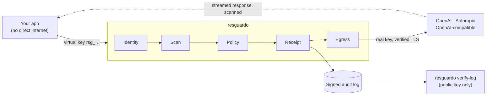

<h1 align="center">Resguardo</h1>

<p align="center">
  <strong>An egress boundary for LLM traffic.</strong><br>
  Nothing leaves without policy, and every decision leaves a signed receipt.
</p>

<p align="center">
  <a href="LICENSE"></a>
  
  
  
</p>

<p align="center">
  <a href="#why-resguardo">Why</a> ·
  <a href="#how-a-request-flows">How it works</a> ·
  <a href="#try-it-today">Try it</a> ·
  <a href="#security-model">Security model</a> ·
  <a href="#roadmap">Roadmap</a> ·
  <a href="#design-documents">Design</a>
</p>

<p align="center"><em>resguardo</em> (Spanish): both a safeguard and a receipt.</p>

---

> [!WARNING]
> **Pre-alpha.** The proxy runs end to end against the mock provider: virtual keys, strict parsing, model allowlists, rate limits and egress. Scanning (M2) and the signed audit log (M5) do not exist yet, so `resguardo run` refuses real providers. Sections marked *planned* describe v0.1. Do not use it to protect anything yet.

## Why Resguardo

Every prompt your application sends to a model provider leaves your network. It may carry customer data, API keys pasted into a support chat, or whatever a prompt injection convinced an agent to read. Most teams cannot answer two simple questions: **what left, and who allowed it?**

Resguardo is a single Rust binary that sits between your applications and the OpenAI and Anthropic APIs, or in front of any OpenAI-compatible server you already run (LiteLLM, vLLM, Ollama…). Applications keep using the official SDKs: change the base URL and the key, nothing else.

| | |
| --- | --- |
| 🔒 **Closed by default** | Only listed providers and models get through. Applications never see a real provider key. Any internal error blocks the request instead of letting it pass. |
| 🧾 **A signed receipt for every decision** | A hash-chained, Ed25519-signed log (RFC 8785 canonical JSON) that anyone can verify with the public key. It records decisions, never prompt content. |
| 🇪🇸 **Spanish data, validated** | DNI, NIE, CIF and IBAN are detected only when their check digit is valid, and the false-positive rate will be measured on a public corpus and published. |
| ⚡ **One small binary** | No database, no runtime services: a TOML file, a JSONL log and a key pair. Latency overhead will be benchmarked and published. |

## How a request flows



1. **Identity.** The virtual key is hashed and looked up. Unknown or expired keys get `401`.
2. **Limits.** Body size, message count and requests per minute, per application.
3. **Scan.** Text is de-obfuscated (Unicode NFKC, invisible characters, Base64, hex, URL encoding) and checked by deterministic detectors.
4. **Policy.** Each data class maps to `allow`, `flag`, `redact` or `block`; the most restrictive wins. Nothing allowed explicitly gets through.
5. **Receipt.** The decision is written and signed **before** anything leaves. If it cannot be written, the request is blocked.
6. **Egress.** Only to configured hosts, with the real credential injected, verified TLS and no redirects.
7. **Response.** Streamed back through a scanner that removes remote images and links outside an allowlist, the usual exfiltration path after a prompt injection.

## Try it today

Requires a stable Rust toolchain (pinned by `rust-toolchain.toml`) and a C compiler, used to build the TLS crypto library.

```sh
git clone https://github.com/christianivanov/resguardo && cd resguardo

# Validate a configuration: every problem is reported at once, and Resguardo refuses to start on any of them.
cargo run -p resguardo -- config check --config config/resguardo.example.toml
# config/resguardo.example.toml: OK (2 upstream(s), 1 principal(s))

# Create a virtual key: the key goes to stdout once, its SHA-256 to stderr.
cargo run -p resguardo -- key create --principal support-bot
# rsg_<43 random Base62 characters>
# Add this line to the [[principal]] entry with id = "support-bot":
#     key_sha256 = "<64 hex characters>"

# Start the fake OpenAI and Anthropic server used by the tests.
cargo run -p resguardo-mock-upstream -- --listen 127.0.0.1:9000

# Run the proxy in front of it. Until scanning and the signed audit log exist, `run` refuses
# any upstream that is not local (allow_insecure_upstream = true).
cargo run -p resguardo -- run --config my-local-config.toml
curl http://127.0.0.1:8787/v1/chat/completions \
  -H "authorization: Bearer rsg_..." -H "content-type: application/json" \
  -d '{"model":"gpt-4.1-mini","messages":[{"role":"user","content":"hola"}]}'
```

### Planned usage (v0.1)

```sh
resguardo init                                   # example config, log folder, signing key pair
resguardo run --config resguardo.toml
resguardo verify-log data/audit.jsonl --pubkey data/signing.pub
```

```python
from openai import OpenAI

client = OpenAI(base_url="http://127.0.0.1:8787/v1", api_key="rsg_...")  # virtual key
client.chat.completions.create(
    model="gpt-4.1-mini",
    messages=[{"role": "user", "content": "Mi DNI es 12345678Z"}],
)
# The provider receives: "Mi DNI es [REDACTED:es_id:1]"
```

Coding agents work the same way: Claude Code only needs `ANTHROPIC_BASE_URL` pointed at Resguardo ([research notes](docs/research/claude-code-gateway.md)).

## Security model

**Resguardo fails closed.** A scanning error, a policy error, an unwritable audit log, a malformed request or an ambiguous configuration all end in a blocked request, never in an unscanned one.

What is already enforced in code:

- **Virtual keys:** 256 bits from the operating system's random generator, encoded without modulo bias; only their SHA-256 is stored; printed once and never logged. Two different keys in `Authorization` and `x-api-key` are rejected, not resolved.
- **Configuration:** unknown fields are errors, not ignored settings. Upstreams must be `https://`; plain HTTP is accepted only for `localhost` with an explicit flag. URLs with credentials, queries or fragments are rejected.
- **Strict parsing:** bodies with duplicate keys (even when escaped differently), invalid UTF-8 or trailing data are rejected, so the scanner and the provider can never read different values. Only known query parameters pass, and the upstream path is fixed.
- **Full-body extraction:** every string in the request is handed to the scanner with its JSON Pointer, including content block types that do not exist yet. Only images, audio and PDFs are skipped, and counted.
- **Egress:** only the configured upstream of each provider, at a fixed path; the application's credentials, cookies and every header outside a short allowlist are dropped and the real key is added. No redirects, no automatic retries (one receipt, one request), no proxy taken from the environment, and a size limit on responses.
- **Provider credentials:** read from an environment variable or a file that only its owner can read (anything wider stops startup), held in memory that is wiped on drop, never printed.
- **TLS:** `rustls` with `aws-lc-rs`, offering the hybrid post-quantum key exchange (X25519MLKEM768) first, certificates checked by the operating system's verifier. A test guards the key exchange order and `cargo deny` bans a second crypto provider.
- **Data minimization:** findings carry the class, position and rule, never the matched value. Error messages never echo request content. The audit log stores no prompt content.

What it does **not** do, by design:

- It does not detect prompt injection; it limits what an injection can send out.
- It does not find personal data without a structured format, such as names or addresses.
- It does not scan images in v0.1.
- It only protects traffic that goes through it: applications must not reach the internet directly.
- In pass-through streaming mode, text already sent before a block cannot be recalled.
- Whoever controls the host and the signing key can rewrite the log; external anchoring comes in v0.2.

Threats, mitigations and residual risks are listed in the [threat model](docs/THREAT_MODEL.md).

## Engineering standards

- `#![forbid(unsafe_code)]` in every crate; `unwrap` and `expect` denied outside tests.
- No home-made cryptography: only established crates (`sha2`, `rustls` with `aws-lc-rs`).
- Every buffer, decoding step and recursion has a configurable limit.
- Detectors and policy rules are written test-first against golden vectors computed independently.
- No real provider is ever called in tests: a [mock provider](tools/mock-upstream) speaks both APIs, including streaming and failure modes.
- The official OpenAI and Anthropic Python SDKs are run against Resguardo ([`tools/sdk-smoke`](tools/sdk-smoke/run.sh)), with versions pinned by hash.
- `cargo deny` enforces licenses, sources and the crate boundaries below.

```text
resguardo (binary) ─┬─ resguardo-core      domain types, configuration, virtual keys
                    ├─ resguardo-scan      detectors (pure: no I/O, no clock)
                    ├─ resguardo-policy    decisions (pure)
                    ├─ resguardo-proto     OpenAI and Anthropic formats, SSE
                    ├─ resguardo-audit     hash-chained, signed log
                    └─ resguardo-egress    allowlist, credentials, TLS (cannot depend on scan or policy)
```

## Roadmap

| Milestone | Scope | Status |
| --- | --- | --- |
| **M0** | Workspace, licenses, ADRs, threat model draft | ✅ Done |
| **M1** | Basic proxy: both APIs, virtual keys, egress allowlist | ✅ Done |
| M2 | Scanning engine: de-obfuscation, secrets, invisible text | ⏳ |
| M3 | Spanish validators, policy and redaction | ⏳ |
| M4 | Streaming: SSE parser, overlap window, response controls | ⏳ |
| M5 | Signed audit log and `verify-log` | ⏳ |
| M6 | Accuracy corpus, benchmark, exfiltration lab, release | ⏳ |

<details>
<summary>M1 in detail (done)</summary>

- [x] M1.1 Domain types and validated configuration (`resguardo config check`)
- [x] M1.2 Mock OpenAI and Anthropic server
- [x] M1.3 Virtual keys (`resguardo key create`), lookup by hash, expiry
- [x] M1.4 Strict parsing and full-body text extraction for both APIs, unknown fields untouched
- [x] M1.5 Egress: allowlist, credential injection, post-quantum TLS, no redirects or retries
- [x] M1.6 HTTP server (`resguardo run`), Annex H errors in each API's shape, rate limits, G.3 cases without scanning
- [x] Done criterion: the official OpenAI and Anthropic SDKs reach the mock through Resguardo (`tools/sdk-smoke/run.sh`)

</details>

Target for v0.1.0: February 2027.

## Design documents

- [Threat model](docs/THREAT_MODEL.md)
- Architecture decisions:
  [0001 single process](docs/adr/0001-single-process-with-crate-boundary.md) ·
  [0002 closed by default](docs/adr/0002-closed-by-default.md) ·
  [0003 signed audit log](docs/adr/0003-signed-audit-log-format.md) ·
  [0004 deterministic detectors](docs/adr/0004-deterministic-detectors-only.md) ·
  [0005 OpenAI-compatible upstream](docs/adr/0005-openai-compatible-upstream.md) ·
  [0006 TLS crypto provider](docs/adr/0006-tls-crypto-provider.md) ·
  [0007 strict request parsing](docs/adr/0007-strict-request-parsing.md)
- Research: [running Claude Code through Resguardo](docs/research/claude-code-gateway.md)
- Ideas kept out of v0.1: [LATER.md](LATER.md)

## Contributing

The project is not ready for outside contributions yet. Commits require a [DCO](https://developercertificate.org/) sign-off (`git commit -s`).

## License

Apache License 2.0. See [LICENSE](LICENSE) and [NOTICE](NOTICE).
