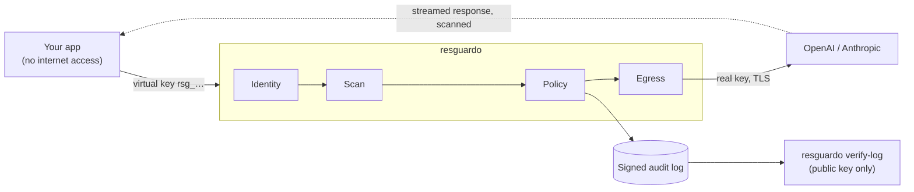

<h1 align="center">Resguardo</h1>

<p align="center">
  <strong>An egress boundary for LLM traffic: nothing leaves without policy, and every decision leaves a signed receipt.</strong>
</p>

<p align="center">
  <a href="LICENSE"></a>
  
  
</p>

<p align="center"><em>resguardo</em> (Spanish): both a safeguard and a receipt.</p>

---

> [!WARNING]
> **Pre-alpha.** The design is done and implementation is under way: configuration validation (`resguardo config check`), virtual key generation (`resguardo key create`) and a mock provider for tests work today; the proxy itself does not yet. This README describes what v0.1 will do. Do not use it to protect anything.

## What it is

Resguardo is a single Rust binary that sits between your application and the OpenAI and Anthropic APIs, or in front of any OpenAI-compatible server you already run (LiteLLM, vLLM, Ollama…). Your app talks to it exactly as it would talk to the provider: change the base URL and the key, nothing else.



## Why it is different

Many proxies redact personal data before calling a model. Resguardo is built around a combination of four things:

| | |
| --- | --- |
| 🔒 **Closed by default** | Only listed providers and models get through. Your app never sees the real provider key. Any internal error blocks the request instead of letting it pass. |
| 🧾 **A signed receipt for every decision** | A hash-chained log, canonicalized with RFC 8785 and signed with Ed25519, that anyone can verify with the public key. It stores no prompt content. |
| 🇪🇸 **Spanish data, validated** | DNI, NIE, CIF and IBAN are detected only when their check digit is valid, and the false-positive rate is measured and published. |
| ⚡ **One small binary** | Rust, no `unsafe`, and a published benchmark of the latency it adds. |

## Planned for v0.1

- OpenAI Chat Completions and Anthropic Messages, with and without streaming
- Any OpenAI-compatible upstream at its own URL, so Resguardo can sit in front of an existing gateway or a self-hosted model
- Virtual keys per application; provider credentials known only to Resguardo
- Per-application allowlists of providers and models, size limits and rate limits
- Deterministic detectors for secrets (cloud keys, tokens, private keys, JWTs, high entropy), invisible characters, Spanish IDs, IBANs, cards (Luhn), Spanish phones and emails
- De-obfuscation before scanning: Unicode NFKC, zero-width characters, Base64, hex and URL encoding
- Per data class actions: `allow`, `flag`, `redact` or `block`
- Response controls: strip remote Markdown images and links to hosts outside the allowlist, which are the usual exfiltration path after a prompt injection
- Streaming scanned with an overlapping window, so a secret split across two chunks is still caught
- `resguardo verify-log` to check the whole audit chain
- An exfiltration lab: the same attack with and without Resguardo, on an isolated Docker network

## How it will look

```sh
resguardo init                            # example config, log folder, signing key pair
resguardo key create --principal support-bot
resguardo run --config resguardo.toml
```

```python
from openai import OpenAI

client = OpenAI(base_url="http://127.0.0.1:8787/v1", api_key="rsg_...")  # virtual key
client.chat.completions.create(
    model="gpt-4.1-mini",
    messages=[{"role": "user", "content": "Mi DNI es 12345678Z"}],
)
# The provider receives: "Mi DNI es [REDACTED:es_id:1]"
```

```sh
resguardo verify-log data/audit.jsonl --pubkey data/signing.pub
```

## What it does not do

Being honest about limits is part of the design:

- It does not detect prompt injection; it limits what an injection can send out.
- It does not find personal data without a structured format, such as names or addresses.
- It only protects what goes through it: your app must not be able to reach the internet directly.
- In pass-through streaming mode, text already sent before a block cannot be recalled.
- Whoever controls the host and the private key can rewrite the log; external anchoring comes in v0.2.

The full list is in the [threat model](docs/THREAT_MODEL.md).

## Roadmap

| Milestone | Scope | Status |
| --- | --- | --- |
| M0 | Workspace, licenses, ADRs, threat model draft | ✅ Done |
| M1 | Basic proxy: both APIs without streaming, virtual keys, egress allowlist | 🚧 In progress: config, mock provider and virtual keys done |
| M2 | Scanning engine: de-obfuscation, secrets, invisible text | ⏳ |
| M3 | Spanish validators, policy and redaction | ⏳ |
| M4 | Streaming: SSE parser, overlap window, response controls | ⏳ |
| M5 | Signed audit log and `verify-log` | ⏳ |
| M6 | Accuracy corpus, benchmark, exfiltration lab, release | ⏳ |

Target for v0.1.0: February 2027.

## Design documents

- [Threat model](docs/THREAT_MODEL.md)
- Architecture decisions: [single process](docs/adr/0001-single-process-with-crate-boundary.md), [closed by default](docs/adr/0002-closed-by-default.md), [signed audit log](docs/adr/0003-signed-audit-log-format.md), [deterministic detectors](docs/adr/0004-deterministic-detectors-only.md), [OpenAI-compatible upstream](docs/adr/0005-openai-compatible-upstream.md), [TLS crypto provider](docs/adr/0006-tls-crypto-provider.md)
- Research: [running Claude Code through Resguardo](docs/research/claude-code-gateway.md)

## Contributing

The project is not ready for outside contributions yet. Commits require a [DCO](https://developercertificate.org/) sign-off (`git commit -s`).

## License

Apache License 2.0. See [LICENSE](LICENSE) and [NOTICE](NOTICE).
