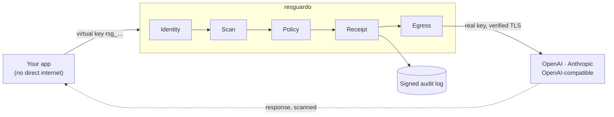

<h1 align="center">Resguardo</h1>

<p align="center">
  <strong>An egress boundary for LLM traffic.</strong><br>
  Nothing leaves without policy, and every decision leaves a signed receipt.
</p>

<p align="center">
  <a href="LICENSE"></a>
  
  
  
</p>

<p align="center">
  <a href="docs/GETTING_STARTED.md">Getting started</a> ·
  <a href="#see-it-stop-an-exfiltration">Demo</a> ·
  <a href="docs/ACCURACY.md">Accuracy</a> ·
  <a href="docs/DEPLOYMENT.md">Deployment</a> ·
  <a href="docs/THREAT_MODEL.md">Threat model</a> ·
  <a href="docs/ARCHITECTURE.md">Architecture</a>
</p>

---

Every prompt your application sends to a model provider leaves your network. It may carry customer data, an API key pasted into a support chat, or whatever a prompt injection convinced an agent to read. Most teams cannot answer two simple questions: **what left, and who allowed it?**

Resguardo is a single Rust binary between your applications and the OpenAI and Anthropic APIs, or any OpenAI-compatible server (LiteLLM, vLLM, Ollama). Applications keep their official SDKs: change the base URL and the key, nothing else. Resguardo blocks or redacts what must not leave, and signs a receipt for every decision.

> [!WARNING]
> **v0.1, not yet released.** Tested end to end with the official SDKs against a mock provider; not yet used in production. Read the [limits](#limits) first.

## See it stop an exfiltration

The same attack twice, on one machine: first through Resguardo (port 18788), then straight to the provider (port 19100).

<p align="center">
  
</p>

Recorded from a real run of [`lab/local-demo.sh`](lab/local-demo.sh) by [`tools/demo/record_svg.py`](tools/demo/record_svg.py); only the long pauses (the build, servers starting) are shortened. The same output as text, unedited:

<details>
<summary>Output</summary>

```console
$ lab/local-demo.sh
== target: http://127.0.0.1:18788
--   network isolation not checked here (it needs the Docker lab)
ok   a provider key in the prompt is blocked
ok   the DNI reached the provider as [REDACTED:es_id:1]
ok   the image pointing at the attacker was removed from the answer

== target: http://127.0.0.1:19100
--   network isolation not checked here (it needs the Docker lab)
LEAK a provider key in the prompt reached the provider
LEAK the DNI reached the provider as written
LEAK the answer carries an image that sends data to the attacker

== receipts
audit.jsonl: OK (6 entries)
== exit codes: protected 0, unprotected 1
```

</details>

The [Docker lab](lab/README.md) adds what one machine cannot show: the application sits on a network whose only way out is Resguardo, so it cannot even reach the attacker directly. Its real output, from a GitHub Actions runner, is in the lab's README.

## Who it is for

- **A support bot or internal assistant** that sends customer messages to OpenAI or Anthropic. Customers paste their DNI, IBAN or phone number; the provider gets `[REDACTED:es_id:1]`.
- **Coding agents** such as Claude Code, which read files and can send a `.env` to the model without anyone noticing. Provider keys and tokens are blocked before they leave.
- **Teams that must show what left.** A security or compliance team, or a data protection officer, can check every decision with a public key, without trusting the operator's word or database.

## What happens to a request

| The application sends… | Resguardo… | The receipt says |
| --- | --- | --- |
| `hola, ¿cómo va mi pedido 12345678?` | forwards it byte for byte | `allow` |
| `Mi DNI es 12345678Z` | forwards `Mi DNI es [REDACTED:es_id:1]` | `redact`, `{"es_id": 1}` |
| `my key is AKIA…` | answers `403 SENSITIVE_DATA`; nothing leaves | `block`, `secret` |
| a model that is not on the key's list | answers `403 MODEL_NOT_ALLOWED`; nothing leaves | `block` |
| anything, while the disk is full | answers `503 AUDIT_UNAVAILABLE`; nothing leaves | — |

| The model answers… | The application gets… | The receipt says |
| --- | --- | --- |
| `Done `, after a prompt injection | `Done [image removed]` | `{"images_removed": 1}`, never the URL |
| `[docs](https://unknown.test/…)` | `docs`; links to hosts on the allowlist stay | `{"links_removed": 1}` |
| a provider key, split across two stream events | the stream cut with an error event | `aborted`, `secret` |

Every decision is a line in a hash-chained, Ed25519-signed log that never holds prompt content. `resguardo verify-log` checks it with the public key.

## Try it

No API key is needed and no real provider is contacted: everything runs against a mock provider. You need Rust, a C compiler and, for the SDK test, [uv](https://docs.astral.sh/uv/). The first build takes a few minutes.

```console
$ git clone https://github.com/christianivanov/resguardo && cd resguardo
$ lab/local-demo.sh              # the attack above, with and without Resguardo
$ tools/sdk-smoke/run.sh         # the official OpenAI and Anthropic SDKs through Resguardo
ok   openai: chat completion through Resguardo
ok   anthropic: message with the key in x-api-key
...
ok   openai: a DNI reaches the provider redacted  (echo: Mi DNI es [REDACTED:es_id:1])
ok   openai: an AWS key -> PermissionDeniedError
...
ok   audit log verifies: OK (30 entries)
```

To set it up step by step, with your own configuration and keys, see [Getting started](docs/GETTING_STARTED.md).

## How it works



From the application's side, only two lines change:

```python
from openai import OpenAI

client = OpenAI(
    base_url="http://127.0.0.1:8787/v1",  # Resguardo instead of api.openai.com
    api_key="rsg_...",                     # a virtual key instead of the real one
)
```

- 🔒 **Closed by default.** Only listed providers and models get through, the application never holds a real provider key, and any internal error blocks the request.
- 🧾 **A signed receipt for every decision,** flushed to disk before anything leaves. Anyone verifies the log with the public key.
- 🇪🇸 **Spanish data, validated.** DNI, NIE, CIF, IBAN and cards count only when their check digit is valid, also when hidden in Base64, full-width digits or zero-width characters.
- 🛡️ **Security first.** No `unsafe`; strict parsing, so the scanner and the provider never read different values; post-quantum TLS to the provider; requests without findings forwarded byte for byte, so prompt caching keeps working.
- ⚡ **One small binary.** No database and no services to run: a TOML file, a JSONL log and a key pair.

## Accuracy and cost

Both reproduce with one command: [`resguardo accuracy`](docs/ACCURACY.md) and [`resguardo-bench`](docs/BENCHMARKS.md).

**Accuracy,** on a synthetic Spanish corpus of 406 texts (306 that look sensitive and are not):

| Class | False positives | Missed |
| --- | --- | --- |
| Spanish ids (DNI, NIE, CIF) | 0.3 % | 3 of 39, all a known gap: an id glued to letters |
| IBAN, email, provider keys | 0 % | 0 |
| Cards | 0.7 % | 0 |
| Phones | 2.9 %, all of them ISBNs | 0 |

`resguardo accuracy --baseline fixtures/accuracy/baseline.json` fails if any detector gets worse than the numbers above.

**Cost,** per request, measured on a standard GitHub Actions runner (Linux, 4 vCPUs of an AMD EPYC) against a local mock:

| | p50 | p99 |
| --- | --- | --- |
| What Resguardo adds: parsing, scanning, policy, signing the receipt and flushing it to disk, the extra hop | **0.5 ms** | 4.0 ms |
| The same without flushing the receipt (`fsync` off) | 0.25 ms | 0.28 ms |

The p99 is the disk: now and then flushing the receipt before the request leaves takes longer. A runner is a shared virtual machine, so take these as an order of magnitude and measure on your own disk ([how](docs/BENCHMARKS.md)). Throughput under concurrency is not measured yet.

## How it compares

Gateways such as LiteLLM, Portkey or Bifrost route traffic across many providers, manage keys and budgets, and can mask personal data. Resguardo does less, on purpose:

- **It is an egress boundary, not a router.** Closed by default: a destination or model not on the key's list never gets a request, and the application never holds a real provider key.
- **Every decision has a signed receipt** that a third party verifies with a public key, without trusting the operator's database.
- **Spanish identifiers are validated**, not just matched, and the error rates are published.
- **It is one binary** with no database or services to run.

What it does not do: load balancing, fallbacks, caching, budgets, dashboards, embeddings, images, or any provider API beyond OpenAI Chat Completions and Anthropic Messages. Put it behind your gateway, or in front of a single provider.

## Roadmap

| | Milestone | Status |
| --- | --- | --- |
| M0 | Foundations: workspace, licenses, ADRs, threat model | ✅ |
| M1 | Proxy: both APIs, virtual keys, limits, egress with post-quantum TLS | ✅ |
| M2 | Detectors: secrets, invisible text, de-obfuscation, `resguardo scan` | ✅ |
| M3 | Spanish ids, IBAN, cards, phones and email; policy and redaction | ✅ |
| M4 | Streaming, response scanning, image and link controls, fuzzing | ✅ |
| M5 | Signed audit log, `resguardo init` and `resguardo verify-log` | ✅ |
| M6 | Accuracy corpus, benchmark, exfiltration lab, deployment guide and release | 🚧 v0.1.0 tag pending |

Next, in v0.2: model-based detectors for unstructured personal data, MCP traffic, workload identity (mTLS, SPIFFE), and timestamped, externally anchored receipts.

## Limits

Being honest about limits is part of the design:

- Resguardo does not detect prompt injection; it limits what an injection can send out.
- It does not find personal data without a structured format, such as names, and it does not scan images.
- It only protects traffic that goes through it: applications must not be able to reach the internet directly ([deployment](docs/DEPLOYMENT.md)).
- It speaks plain HTTP to applications: keep it on the same host or a private network, or put a TLS terminator in front.
- With the default stream mode, the first half of a secret split across two stream events reaches the application before the stream is cut; `buffer` mode avoids it.
- Whoever controls the host and the signing key can rewrite the log consistently, and deleting its last entries leaves a valid, shorter log. Keep copies elsewhere.

The full list, with what covers each limit later, is in the [threat model](docs/THREAT_MODEL.md#7-explicitly-not-protected-in-v01).

## Documentation

- [Getting started](docs/GETTING_STARTED.md): the demo, a step-by-step setup, SDK usage, receipts and error codes
- [Deployment](docs/DEPLOYMENT.md): Docker, Kubernetes, VMs, and operating it
- [Accuracy](docs/ACCURACY.md) and [benchmarks](docs/BENCHMARKS.md)
- [Architecture and security](docs/ARCHITECTURE.md): crates, request path and the controls in code today
- [Threat model](docs/THREAT_MODEL.md) and [architecture decisions](docs/adr/)
- [Running Claude Code through Resguardo](docs/research/claude-code-gateway.md)

## Contributing

Not open to outside contributions yet. Commits require a [DCO](https://developercertificate.org/) sign-off (`git commit -s`). To report a vulnerability, see [SECURITY.md](SECURITY.md): privately, please.

## License

[Apache-2.0](LICENSE). *Resguardo* is Spanish for both a safeguard and a receipt.
